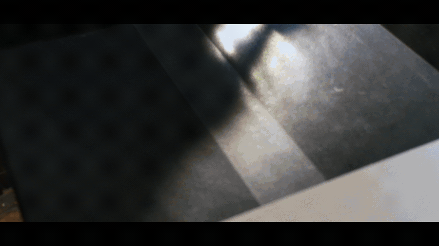
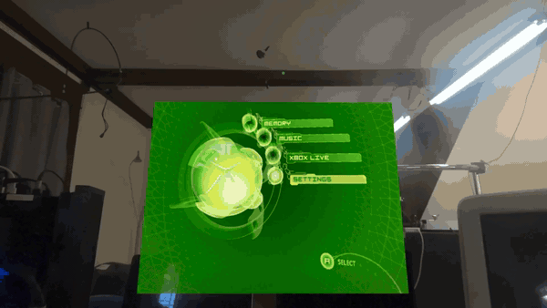
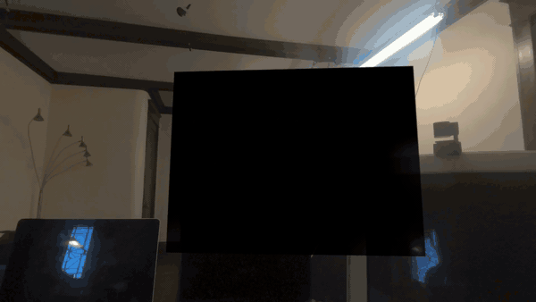

# Xbawks

[](https://youtu.be/AnmeuEjDdMU)

An original Xbox emulator for Apple Vision Pro, running on the headset itself. It is a port of [xemu](https://xemu.app), which is a fork of QEMU, with a visionOS shell around it: a JIT that works within the platform's rules, a screen inside an immersive space, and the PSVR2 Sense controllers as the gamepad.

As far as I can find, it is the first standalone, JIT based original Xbox emulator on the platform. The dashboard boots, a retail disc boots, and the game runs at its own frame rate on the headset's M5.

**What you need, before anything else:**

- **[Apparition](https://apparition.illixion.com) on a Mac on the same network, every time you launch.** visionOS will not let an app make its own memory executable, and an emulator's JIT needs exactly that. Apparition attaches as a debugger for about two seconds at launch, prepares the code buffer, and detaches; without it the emulator refuses to start and says so in its log. This is not optional and there is no workaround on current visionOS. See [Why it needs a debugger to start](#why-it-needs-a-debugger-to-start).
- **Your own console's files.** Xbawks ships no Microsoft code and no game data: no boot ROM, no BIOS, no disc images. You supply them from your own hardware. See [What you bring](#what-you-bring).

The full story of how it got here, every measurement and every wrong turn, is in [`DEVLOG.md`](DEVLOG.md).





Recorded through the headset's passthrough camera, so the room behind the screen is real. Both clips are from my own console's files and my own disc; Xbawks ships neither.

## Watch it run

The loop at the top is five seconds. **This is the full thing.**

[](https://youtu.be/AnmeuEjDdMU)

**[Click the image to watch on YouTube](https://youtu.be/AnmeuEjDdMU)**, shot
on the headset rather than in a simulator, with sound.

Ported and maintained by A.Cervantez. xemu and QEMU are the work of their respective projects and are GPL-2.0; so is everything here that touches them.

## What it does today

- Boots the Xbox dashboard and a retail game from a disc image, standalone, no Mac streaming.
- Presents the picture on a 2.8 metre screen in a mixed immersive space, fed straight from the GPU.
- Puts a true scale Xbox in the room. It rests on real tables, you can move it and turn it, and pressing it brings up a Cover Flow deck of your discs. Swapping a disc resets the console and boots the new one, as the hardware would; eject returns to the dashboard. The console can wear thirteen original Xbox editions, solid and translucent, from Standard Black to the Skeleton smoke, Crystal and Halo greens, with an optional glow.
- Takes input from a pair of PSVR2 Sense controllers or a PS4 controller over Bluetooth: sticks, face buttons, analog triggers. With more than one connected, the picker chooses which one plays.
- Skips the Xbox start-up animation if you would rather go straight into the game, a switch in the picker.
- Pauses when you leave and resumes when you come back.

What it does not do yet: save state, or let you move the screen. Higher internal resolution is a switch rather than a setting so far (see `AVP-INSTALL.md`). The devlog has the measurements behind every one of those.

## What runs

Measured on the headset between 2026-11-10 and 2026-11-17, each title played for a few minutes from my own discs. Frame rates are the median over the session; the original hardware ran Halo at 29.5 fps average. All of these are discs I own; the build carries none of them.

| Title | Result | Notes |
|---|---|---|
| Halo: Combat Evolved | Plays | 29.4 fps, matching the original console. Cutscenes drift from their audio when a scene runs slow. |
| Dead or Alive 2 Ultimate | Plays | 60 fps, its full cap. The title upstream used to measure the vertex work this port carries. |
| Jet Set Radio Future | Plays | 60 fps. The boost effect dips to about 25 for its duration, a known cost upstream too. |
| Doom 3 | Plays | 32 fps, locked, the flattest line of anything here, at native resolution or at twice it. The first-rocket stutter is gone now that pipelines are cached between launches. |
| Project Gotham Racing 2 | Plays | 28 fps on a 30 fps target. Looks right; feels a little less smooth than it should. |
| Blinx: The Time Sweeper | Plays | 33 fps on Deja Vu Canals, which ran at 6 before the vertex work. |
| Cel Damage | Plays | 32 fps, up from 25 once x87 floating point ran on the headset's own hardware. |
| Fuzion Frenzy | Plays | Launch title, no issues seen in a short run. |
| Halo 2 | Plays | 33 fps through the Cairo Station firefight, memory flat at 4.6 GB. HUD, menus and scope all draw, and nothing else looked wrong. |
| The Elder Scrolls III: Morrowind | Plays | 18 to 28 fps outdoors in Balmora, 65 indoors, measured before the x87 change. A save in Balmora loads in under a minute, down from four. Hung on the prison ship until 2026-11-15; see the devlog for what it was waiting on. |

"Plays" means I played it through; anything that looked wrong is in its notes. "Starts" means it got to gameplay and then failed in a way that is recorded in the devlog with the numbers.

## Why it needs a debugger to start

visionOS does not let an app make memory executable, which is what an emulator's JIT needs. The way through, found by the StikDebug and Apparition projects, is that a debugger may write into an app's memory, and a page a debugger has written to may run code after it disconnects. So Xbawks allocates its code buffer, stops itself and asks for the pages to be touched; [Apparition](https://apparition.illixion.com) on a Mac on the same network attaches for about two seconds and detaches. After that the emulator writes and runs code on its own for the rest of the session.

One rule that took days to find and is written nowhere: the buffer has to be created executable and mirrored writable, never the other way round. Memory the app created as writable can never become executable, whatever is mapped over it later.

## Why there is no window

With the immersive space open, the Sense controllers belong to the app, except while you are looking at one of the app's windows; then visionOS turns them back into that window's pointer. So the game is a plane inside the space, and the only window is a small launcher that opens the space and gets out of the way. Everything you touch during play is an object in the room instead: the console itself is the control, and the disc deck it brings up is attached to it, because a window opened mid session sends the whole space to the background and pauses the machine.

## Building and installing

You need a Mac with Xcode, a Vision Pro on visionOS 26 or later, a free Apple developer account, and Apparition installed on both. The steps, the cross compile, and the signing are in `tools/xros/README.md`. The short version:

```sh
tools/xros/make-app.sh        # cross compile and assemble the bundle
tools/xros/sign-install.sh    # sign with your profile
xcrun devicectl device install app --device <udid> build-app/Xbawks.app
apparition jit <bundle id>    # launch; attaches, prepares, detaches
```

## What you bring

Xbawks ships no game data and no Microsoft code, and it never downloads any. Like xemu, it needs four things you supply yourself, placed in the app's `Documents` folder in Files:

- an **MCPX boot ROM** and a **BIOS image**, both Microsoft's, from your own console
- a **hard disk image**, which xemu's own tooling creates blank, and which then holds your saves
- your **disc images**, from discs you own, in `Documents/GAMES`

None of these are part of this repository or of any build it produces. The build script copies nothing unless a variable names it explicitly for that run, and refuses to produce an IPA at all if it did; `.gitignore` denies the files and a push guard refuses them on every remote, as backstops. Run the build with nothing set and list the output: that is the test, and it is what the repository is held to.

## Layout

```
patches/        changes to xemu and QEMU, as patches against the upstream checkout
tools/xros/     the visionOS build, bundle and signing scripts
probes/         the JIT probe that found the rules, and the SDK watcher
DEVLOG.md       every measurement, in order, including the wrong turns
UPSTREAM.md     which xemu the patches apply to
```

## Licence

GPL-2.0, as xemu and QEMU. Licence headers on upstream files are untouched.
