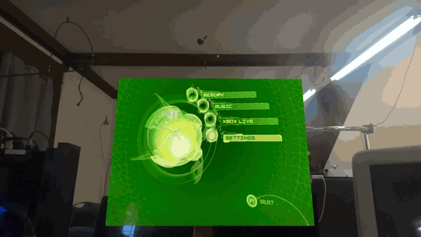
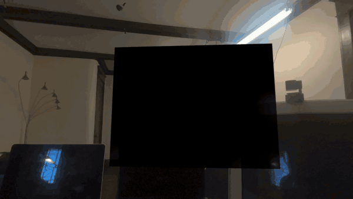

# Xbawks

An original Xbox emulator for Apple Vision Pro, running on the headset itself. It is a port of [xemu](https://xemu.app), which is a fork of QEMU, with a visionOS shell around it: a JIT that works within the platform's rules, a screen inside an immersive space, and the PSVR2 Sense controllers as the gamepad.

As far as I can find, it is the first standalone, JIT based original Xbox emulator on the platform. The dashboard boots, a retail disc boots, and the game runs at its own frame rate on the headset's M5.





Recorded through the headset's passthrough camera, so the room behind the screen is real. Both clips are from my own console's files and my own disc; Xbawks ships neither.

Ported and maintained by A. Cervantez. xemu and QEMU are the work of their respective projects and are GPL-2.0; so is everything here that touches them.

## What it does today

- Boots the Xbox dashboard and a retail game from a disc image, standalone, no Mac streaming.
- Presents the picture on a two metre screen in a mixed immersive space, fed straight from the GPU.
- Takes input from a pair of PSVR2 Sense controllers (or an extended gamepad): sticks, face buttons, analog triggers.
- Pauses when you leave and resumes when you come back.

What it does not do yet: run at the internal scale it could (the screen shows the guest's 640x480), save state, show a menu, or let you move the screen. The devlog has the measurements behind every one of those.

## Why it needs a debugger to start

visionOS does not let an app make memory executable, which is what an emulator's JIT needs. The way through, found by the StikDebug and Apparition projects, is that a debugger may write into an app's memory, and a page a debugger has written to may run code after it disconnects. So Xbawks allocates its code buffer, stops itself and asks for the pages to be touched; [Apparition](https://apparition.illixion.com) on a Mac on the same network attaches for about two seconds and detaches. After that the emulator writes and runs code on its own for the rest of the session.

One rule that took days to find and is written nowhere: the buffer has to be created executable and mirrored writable, never the other way round. Memory the app created as writable can never become executable, whatever is mapped over it later.

## Why there is no window

With the immersive space open, the Sense controllers belong to the app, except while you are looking at one of the app's windows; then visionOS turns them back into that window's pointer. So the game is a plane inside the space, and the only window is a small launcher that opens the space and gets out of the way.

## Building and installing

You need a Mac with Xcode, a Vision Pro on visionOS 26 or later, a free Apple developer account, and Apparition installed on both. The steps, the cross compile, and the signing are in `tools/xros/README.md`. The short version:

```sh
tools/xros/make-app.sh        # cross compile and assemble the bundle
tools/xros/sign-install.sh    # sign with your profile
xcrun devicectl device install app --device <udid> build-app/XemuHost.app
apparition jit <bundle id>    # launch; attaches, prepares, detaches
```

## What you bring

Xbawks ships no game data. Like xemu, it needs an MCPX boot ROM, a BIOS image, a hard disk image and your own disc images, which you obtain from your own console. They are never part of this repository, and `.gitignore` refuses them as a backstop.

## Layout

```
patches/        changes to xemu and QEMU, as patches against the upstream checkout
tools/xros/     the visionOS build, bundle and signing scripts
probes/         the JIT probe that found the rules, and the SDK watcher
DEVLOG.md       every measurement, in order, including the wrong turns
UPSTREAM.md     which xemu the patches apply to
```

## Licence

GPL-2.0, as xemu and QEMU. Licence headers on upstream files are untouched.
